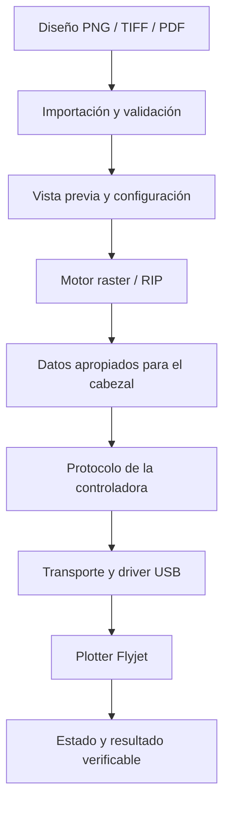
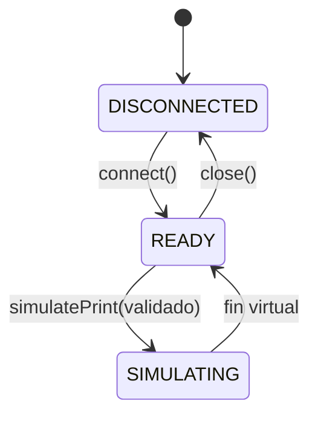
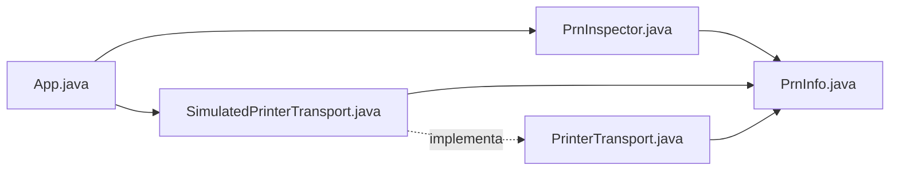
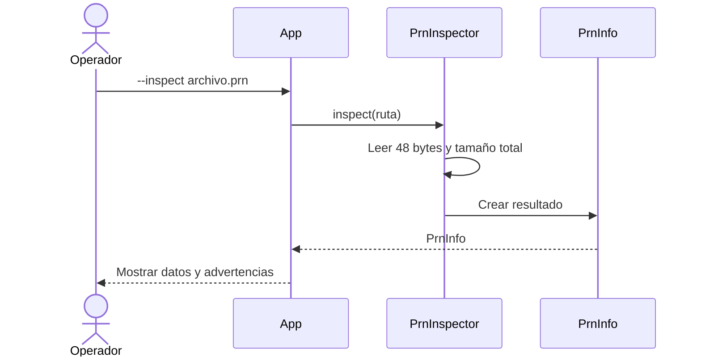
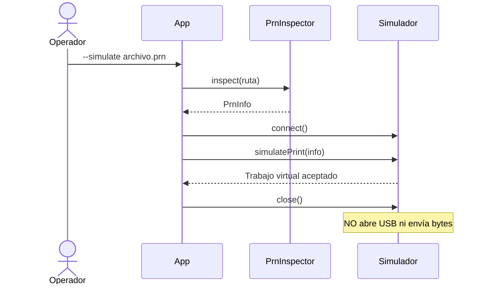
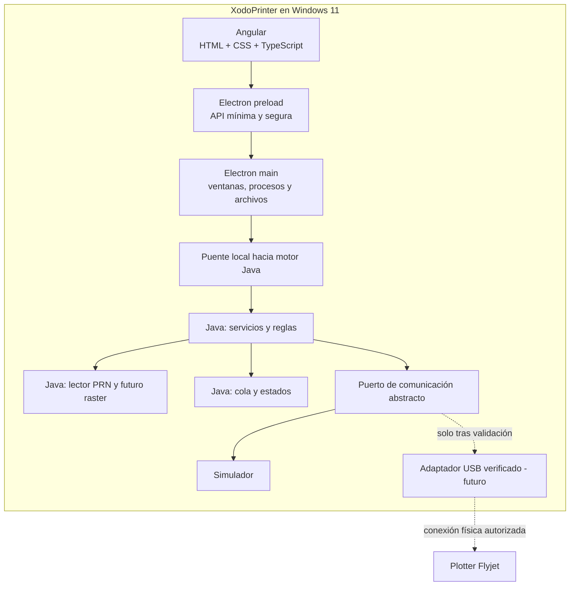

# XodoPrinter: guía para comprender el código y construir nuestra aplicación de escritorio

> **Actualización de XodoPrinter:** paquetes `twdev.xodoprinter`, Maven `twdev:xodoprinter` y objetivo Java 25. Se verificaron la compilación Maven, el JAR ejecutable y `--self-test` con JDK 25. Las referencias a pruebas con Java 21 corresponden a la validación histórica del prototipo. Consulta el `README.md` para `run.ps1` y la configuración de `JAVA_HOME`.

> **Guía de estudio y desarrollo, edición 1.0 · 23 de octubre de 2026**\
> Proyecto de partida: **`xodoprinter-v0.1-src.zip`** · Versión del código: **0.1.0-SNAPSHOT**\
> Plataforma objetivo: **Windows 11 x64** · Tecnologías objetivo: **Angular + Electron + Java**\
> Equipo objetivo: Flyjet WD3200-3225, identificación USB observada `VID_7856&PID_0100`.

**¿Para quién es?** Para una persona que conoce los fundamentos de Java y quiere aprender, desde la práctica, a crear una aplicación de escritorio que interactuará con hardware real. No necesitas saber todavía cómo desarrollar controladores USB ni cómo funciona Electron.

**Cómo leer el documento:** cada vez que aparezca **[EXISTE EN 0.1]**, describimos código que comprobé en el proyecto que ya recibiste; **[PROPUESTA]** indica una decisión de arquitectura o código que *todavía no existe*; **[POR VALIDAR]** indica una hipótesis técnica sobre archivos de impresión o sobre el dispositivo. Esta distinción es fundamental.

**Regla de seguridad del proyecto:** la computadora **Windows 7 de producción no se modifica**. Nada de instalaciones, reinicios, desconexiones, cambios de controlador ni capturas invasivas. Nuestro laboratorio es la computadora con Windows 11; el análisis actual es completamente offline. No enviaremos comandos experimentales al plotter.

---

## Índice de estudio

1. [Qué estamos construyendo y qué NO existe todavía](#1-qué-estamos-construyendo-y-qué-no-existe-todavía)
2. [El panorama general: de una imagen al plotter](#2-el-panorama-general-de-una-imagen-al-plotter)
3. [Preparar el entorno y abrir el proyecto](#3-preparar-el-entorno-y-abrir-el-proyecto)
4. [Mapa exacto de los archivos de XodoPrinter 0.1](#4-mapa-exacto-de-los-archivos-de-xodoprinter-01)
5. [Qué hace Maven y qué significa `pom.xml`](#5-qué-hace-maven-y-qué-significa-pomxml)
6. [Entender `App.java`, el punto de entrada](#6-entender-appjava-el-punto-de-entrada)
7. [Entender `PrnInfo.java`: el modelo de datos](#7-entender-prninfojava-el-modelo-de-datos)
8. [Entender `PrnInspector.java`: lectura binaria de un PRN](#8-entender-prninspectorjava-lectura-binaria-de-un-prn)
9. [Entender `PrinterTransport` y su simulador](#9-entender-printertransport-y-su-simulador)
10. [Cómo se conectan las clases y qué ocurre en cada ejecución](#10-cómo-se-conectan-las-clases-y-qué-ocurre-en-cada-ejecución)
11. [Pruebas, errores y pequeñas mejoras de aprendizaje](#11-pruebas-errores-y-pequeñas-mejoras-de-aprendizaje)
12. [Nueva arquitectura: Angular + Electron + Java](#12-nueva-arquitectura-angular--electron--java)
13. [Cómo organizar el repositorio sin perder lo que ya funciona](#13-cómo-organizar-el-repositorio-sin-perder-lo-que-ya-funciona)
14. [Cómo desarrollar una función nueva de principio a fin](#14-cómo-desarrollar-una-función-nueva-de-principio-a-fin)
15. [Plan de trabajo gradual y criterios para avanzar](#15-plan-de-trabajo-gradual-y-criterios-para-avanzar)
16. [Qué necesitamos aprender sobre impresión industrial y USB](#16-qué-necesitamos-aprender-sobre-impresión-industrial-y-usb)
17. [Buenas prácticas de equipo, Git y documentación](#17-buenas-prácticas-de-equipo-git-y-documentación)
18. [Glosario y recursos de estudio](#18-glosario-y-recursos-de-estudio)
19. [Tu primera sesión de trabajo, paso a paso](#19-tu-primera-sesión-de-trabajo-paso-a-paso)
20. [Lista de comprobación de comprensión](#20-lista-de-comprobación-de-comprensión)

---

## 1. Qué estamos construyendo y qué NO existe todavía

### 1.1 La visión

**XodoPrinter** será una aplicación de escritorio para Windows 11 cuyo propósito final es preparar trabajos, revisarlos visualmente, organizarlos, controlar la comunicación con el plotter Flyjet y producir impresiones reales, de forma más clara y confiable que el software antiguo.

Nuestra meta no es copiar pantallas de PrintExp ni reutilizar sus binarios propietarios en el producto. Lo estudiaremos como **referencia de interoperabilidad**: queremos entender el tipo de datos y el comportamiento que necesita la máquina y crear nuestra implementación propia.

Imagina el uso final:

1. El operador abre **XodoPrinter.exe** desde Windows, incluso sin Internet.
2. Selecciona un diseño y su material.
3. La aplicación muestra tamaño real, posición, márgenes y calidad.
4. El operador revisa los ajustes y confirma el trabajo.
5. El motor prepara los datos necesarios para la impresora.
6. Un adaptador compatible establece comunicación con la controladora del Flyjet.
7. Solo cuando se hayan validado los requisitos del hardware, transmite los datos correspondientes.
8. La pantalla muestra el estado real y los errores que realmente podamos obtener del dispositivo.

**Hoy solo estamos en los pasos preparatorios:** analizar ciertos archivos, conocer su estructura y simular estados. Eso es deliberado: controlar hardware industrial sin entender su protocolo no es un primer experimento seguro.

### 1.2 Estado actual: lo que sí existe

En el ZIP **0.1** existen cinco clases Java:

- `App`: recibe argumentos por consola y decide qué operación ejecutar.
- `PrnInfo`: guarda información extraída de la cabecera de un archivo PRN.
- `PrnInspector`: lee esa cabecera desde un archivo o desde un ZIP.
- `PrinterTransport`: define un contrato muy sencillo para una conexión abstracta.
- `SimulatedPrinterTransport`: simula que acepta un trabajo, **sin tocar ningún USB**.

Además hay `pom.xml`, `.gitignore`, `README.md` y `docs/PLAN_TECNICO_ES.md`.

**Comprobación realizada:** compilé el proyecto con **Java 21**, ejecuté `--self-test` y obtuve `SELF-TEST PASSED`. También ejecuté `--inspect-zip` sobre la copia que compartiste de PrintExp y obtuvo **`Recognized 63/63 offline TestPRN files`**. Esto prueba que el código lee y verifica una regla estructural observada; **no prueba que interprete todos los píxeles correctamente, ni que imprima físicamente**.

### 1.3 Estado actual: lo que todavía NO existe

| Capacidad | Situación real |
|---|---|
| Ventana de escritorio | **No implementada** |
| Angular, HTML y CSS | **No implementados** |
| Electron y empaquetado `.exe` | **No implementados** |
| API entre Java y Angular | **No implementada** |
| Motor RIP/raster para imágenes comunes | **No implementado** |
| Procesamiento completo del contenido PRN | **No implementado** |
| Cola persistente de trabajos | **No implementada** |
| Comunicación real con USB | **No implementada** |
| Compatibilidad probada con Windows 11 y hardware real | **No demostrada** |
| Simulador de estado y validación estructural | **Sí, básico** |

> **Idea clave:** una buena arquitectura permite construir y probar la aplicación sin el plotter, pero la simulación nunca sustituye una validación real.

---

## 2. El panorama general: de una imagen al plotter

Antes de estudiar clases, debemos entender el **problema**. No es solamente enviar un archivo por un cable USB.

### 2.1 Qué responsabilidades hay detrás de «imprimir»



- **Interfaz:** permite al usuario tomar decisiones y entender qué está sucediendo.
- **Motor de trabajos:** organiza el flujo, registra estados y valida permisos y parámetros.
- **Raster/RIP:** transforma el diseño en información adecuada para la tecnología de impresión. Puede necesitar administración de color, perfiles ICC, tramado (*halftoning*), separación de canales y asignación de boquillas.
- **Protocolo:** define qué comandos y paquetes comprende la controladora y en qué orden deben enviarse.
- **Transporte/driver:** establece el canal de comunicación con el dispositivo USB bajo Windows.
- **Seguridad:** impide que parámetros no verificados provoquen movimientos, calentamiento o activación de cabezales.

Las tareas no deben mezclarse en una sola clase. Si mañana cambiamos la interfaz gráfica, **no queremos reescribir el protocolo**. Si el protocolo cambia, no queremos reescribir las pantallas.

### 2.2 El orden en que aprenderemos

Vamos de lo comprobable a lo desconocido:

**Leer datos → entender modelos → simular → probar → diseñar interfaz → integrar procesos → investigar protocolo → ensayar con hardware autorizado.**

La alternativa de empezar directamente por un botón «Imprimir» conectado a un USB desconocido sería más rápida de programar visualmente, pero no sería una solución real ni segura.

---

## 3. Preparar el entorno y abrir el proyecto

### 3.1 Requisitos de la base 0.1

- **Windows 11 de desarrollo:** tu ASUS; no hace falta conectar el plotter.
- **JDK:** versión **25**. El proyecto se compila y ejecuta con Java 25.
- **IntelliJ IDEA:** Community es suficiente.
- **Maven:** el proyecto tiene `pom.xml`. Una instalación de Maven 3.9+ o el Maven de IntelliJ es adecuada.
- **Git:** para registrar cambios y evitar perder una versión que funciona.

**No necesitas todavía** instalar Angular, Electron, WinUSB ni controladores del Flyjet para ejecutar esta base Java.

### 3.2 Abrir el ZIP en IntelliJ

1. En Windows 11 crea una carpeta de trabajo, por ejemplo `C:\Proyectos\xodoprinter`.
2. Extrae el ZIP del código fuente **dentro de esa carpeta**. Debes poder encontrar el archivo `pom.xml`.
3. Abre IntelliJ → **Open** → selecciona la carpeta que contiene `pom.xml`.
4. Si IntelliJ pregunta si debe confiar en el proyecto, verifica que es el código fuente que ya revisaste y procede.
5. Espera a que IntelliJ reconozca la estructura Maven.
6. En **Project Structure** verifica que el **Project SDK** sea JDK 25.
7. Abre `src/main/java/twdev/xodoprinter/App.java`.
8. Ejecuta la clase `App` indicando el argumento `--self-test`.

**Importante:** el ZIP del código que creamos solo contiene código Java y documentos. No contiene las DLL, PRN, llaves USB o controladores del fabricante.

### 3.3 Ejecución desde IntelliJ

En **Run → Edit Configurations** crea una configuración tipo **Application**:

| Campo | Valor |
|---|---|
| Main class | `twdev.xodoprinter.App` |
| Program arguments | `--self-test` |
| JRE | Java 25 |
| Working directory | Carpeta del proyecto |

Resultado esperado, parecido a:

```text
SIMULATOR: accepted ... (3 x 2, 4 channel-units)
SIMULATOR: job completed virtually; NOTHING was printed.
SELF-TEST PASSED (hardware untouched).
```

El nombre y la ubicación temporal del archivo cambian en cada ejecución; eso es normal.

### 3.4 Ejecución desde PowerShell con Maven

En una terminal de **Windows 11**, desde la carpeta del `pom.xml`:

```powershell
java -version
mvn -version
mvn compile
java -cp target/classes twdev.xodoprinter.App --self-test
```

La primera vez que uses Maven puede descargar el plugin de compilación; eso sucede en tu **equipo de desarrollo**, nunca en Windows 7. Si IntelliJ usa un Maven integrado y `mvn` no está disponible en PowerShell, compila y ejecuta desde IntelliJ.

### 3.5 Ejecución sin Maven

También puedes compilar a mano con `javac`. El código 0.1 no tiene bibliotecas externas:

```powershell
New-Item -ItemType Directory -Force out | Out-Null
$fuentes = Get-ChildItem -Path 'src/main/java' -Recurse -Filter '*.java' |
    ForEach-Object { $_.FullName }
javac --release 25 -d out $fuentes
java -cp out twdev.xodoprinter.App --self-test
```

Este ejemplo es para **PowerShell**. Compilar con `javac` es útil para aprender qué hace realmente Maven: traduce archivos `.java` a clases `.class` y organiza su salida.

### 3.6 Modos reales del programa

| Argumento | Para qué sirve | Accede al plotter |
|---|---|---|
| `--self-test` | Genera un PRN sintético temporal y comprueba la lectura + simulación | **No** |
| `--inspect "archivo.prn"` | Lee la cabecera de un PRN y muestra el resultado | **No** |
| `--inspect-zip "copia.zip"` | Busca entradas `TestPRN/*.prn` dentro de una copia ZIP | **No** |
| `--simulate "archivo.prn"` | Verifica un PRN y acepta un trabajo ficticio | **No** |
| Sin argumentos | Muestra el menú de ayuda | **No** |

Ejemplo usando una **copia local** de los datos originales, si decides mantenerla fuera del repositorio:

```powershell
java -cp target/classes twdev.xodoprinter.App --inspect-zip "D:\Laboratorio\PrintExp DX5_lock2 V2.41.zip"
```

En nuestros datos de prueba la salida fue:

```text
Recognized 63/63 offline TestPRN files
```

**Cuidado con el significado de «recognized»:** aquí solamente quiere decir que cumplen dos condiciones observadas: los cuatro primeros bytes esperados y una regla de longitud. No significa que todos sus valores sean semánticamente correctos.

---

## 4. Mapa exacto de los archivos de XodoPrinter 0.1

Esta es la estructura del código tras el cambio de nombre a XodoPrinter:

```text
xodoprinter-v0.1/
├── .gitignore
├── pom.xml
├── README.md
├── docs/
│   └── PLAN_TECNICO_ES.md
└── src/
    └── main/
        └── java/
            └── twdev/
                └── xodoprinter/
                    ├── App.java
                    ├── prnformat/
                    │   ├── PrnInfo.java
                    │   └── PrnInspector.java
                    └── transport/
                        ├── PrinterTransport.java
                        └── SimulatedPrinterTransport.java
```

### 4.1 Cada archivo tiene una sola responsabilidad principal

| Archivo | Responsabilidad | Pregunta que resuelve |
|---|---|---|
| `pom.xml` | Proyecto Maven y configuración del compilador | ¿Cómo se construye el proyecto? |
| `.gitignore` | Excluir archivos del control de versiones | ¿Qué no debemos subir a Git? |
| `README.md` | Instrucciones rápidas del prototipo original | ¿Cómo lo ejecuto? |
| `docs/PLAN_TECNICO_ES.md` | Hallazgos, riesgos y hitos de investigación | ¿Qué sabemos y qué falta? |
| `App.java` | Entrada por consola y selección de comandos | ¿Qué desea ejecutar el usuario? |
| `PrnInfo.java` | Modelo inmutable de metadatos PRN | ¿Qué sabemos sobre este archivo? |
| `PrnInspector.java` | Lectura y comprobación de cabeceras PRN | ¿Qué estructura tiene? |
| `PrinterTransport.java` | Contrato de transporte abstracto | ¿Qué operaciones necesita un transportador? |
| `SimulatedPrinterTransport.java` | Implementación ficticia y segura | ¿Cómo ensayamos sin impresora? |

### 4.2 ¿Por qué las carpetas `twdev/xodoprinter/prnformat`?

Java utiliza **paquetes**. La declaración:

```java
package twdev.xodoprinter.prnformat;
```

indica que esa clase pertenece al espacio de nombres `twdev.xodoprinter.prnformat`. Maven espera que las fuentes estén bajo `src/main/java` y, por convención, que las carpetas sigan el nombre del paquete.

Piensa en paquetes como **cajones temáticos**:

- `prnformat`: todo lo que entiende el formato PRN.
- `transport`: la abstracción para conectarse con un dispositivo o simulador.
- paquete raíz `twdev.xodoprinter`: punto de entrada.

Conforme el programa crezca añadiremos otros cajones, pero todavía **no es necesario crear diez módulos vacíos**.

---

## 5. Qué hace Maven y qué significa `pom.xml`

El `pom.xml` actual tiene esta estructura esencial:

```xml
<groupId>twdev</groupId>
<artifactId>xodoprinter</artifactId>
<version>0.1.0-SNAPSHOT</version>
<properties>
    <maven.compiler.release>25</maven.compiler.release>
    <project.build.sourceEncoding>UTF-8</project.build.sourceEncoding>
</properties>
```

### 5.1 Explicación de sus piezas

- **`groupId`:** identifica el grupo de software. No significa que el proyecto esté publicado.
- **`artifactId`:** nombre técnico del artefacto que Maven puede producir.
- **`version`:** la versión de desarrollo. `SNAPSHOT` significa versión cambiante, no lanzamiento final.
- **`maven.compiler.release = 25`:** compila usando el nivel de API y lenguaje de Java 25. La ejecución requiere Java 25 o posterior.
- **`UTF-8`:** codificación de los fuentes; importante para mensajes en español.
- **`maven-compiler-plugin 3.13.0`:** plugin declarado en el proyecto para compilar fuentes Java.

### 5.2 Maven no es Spring Boot

Este proyecto **no usa Spring Boot**. Maven solamente gestiona la construcción. No tenemos un servidor, REST, base de datos ni dependencias de terceros. Es una decisión apropiada para el primer prototipo, porque simplifica el aprendizaje.

Más adelante podremos añadir una API local Java, quizá con un servidor ligero. No es obligatorio convertir todo el motor de impresión en una aplicación Spring Boot.

### 5.3 Dónde van código y pruebas

Cuando incorporemos pruebas automatizadas tendremos:

```text
src/main/java/       código del producto
src/test/java/       pruebas automatizadas Java
src/main/resources/  recursos del producto, si hacen falta
src/test/resources/  archivos sintéticos de prueba
```

Las carpetas `src/test/...` **todavía no existen** en la base 0.1; las añadiremos cuando instalemos un framework de pruebas como JUnit 5. Maven utiliza esta organización por convención.

### 5.4 Para qué sirve `.gitignore`

El archivo actual excluye cosas como `target/`, `out/`, `.idea/`, `*.class`, `*.prn`, `*.dmp`, `*.log`, `*.sys`, `*.dll` y `*.exe`.

Dos motivos:

1. **No subir resultados generados**: los `.class` y el contenido de `target` pueden volver a construirse.
2. **No publicar material de terceros o sensible**: archivos originales de PrintExp, muestras de producción, volcados de memoria y binarios de drivers no deben entrar accidentalmente en el repositorio.

**Mejora pendiente [PROPUESTA]:** añadir una carpeta excluida, por ejemplo `private-data/`, para guardar copias locales de datos de laboratorio. No coloques allí información de clientes si no necesitas estudiarla. No metas tampoco claves, licencias ni archivos `.ini` de calibración privada en repositorios públicos.

---

## 6. Entender `App.java`, el punto de entrada

### 6.1 Qué hace

Es el programa que se ejecuta cuando escribes `java ... twdev.xodoprinter.App`. Su método principal:

```java
public static void main(String[] args) throws Exception
```

es la **puerta de entrada**. `args` contiene las palabras que escribes después del nombre de la clase.

Ejemplo:

```text
java ... twdev.xodoprinter.App --inspect archivo.prn
```

produce conceptualmente:

```java
args[0] = "--inspect";
args[1] = "archivo.prn";
args.length = 2;
```

El código utiliza `if / else if` para saber qué hacer. Una versión simplificada del código real:

```java
if (args.length == 2 && args[0].equals("--inspect")) {
    describe(PrnInspector.inspect(Path.of(args[1])));
} else if (args.length == 2 && args[0].equals("--inspect-zip")) {
    // Lee las entradas PRN de un ZIP y cuenta cuáles cumplen la regla.
} else if (args.length == 2 && args[0].equals("--simulate")) {
    // Lee un PRN y ejecuta el simulador.
} else if (args.length == 1 && args[0].equals("--self-test")) {
    selfTest();
} else {
    // Muestra la ayuda.
}
```

### 6.2 ¿Por qué `Path.of(args[1])`?

`Path` representa una ruta del sistema de archivos. Evita que tengamos que tratar todas las rutas como cadenas sin estructura.

```java
Path archivo = Path.of("C:\\Laboratorio\\prueba.prn");
```

**Importante:** esta ruta es texto Java; por eso aparecen `\\` para representar cada barra invertida. Al pasar rutas desde PowerShell, basta con escribir la ruta habitual entre comillas si contiene espacios.

### 6.3 El método `describe(PrnInfo p)`

El método no lee bytes ni abre el USB. **Solo toma el resultado** preparado por otra clase y lo imprime:

- Nombre del archivo.
- Longitud del archivo.
- Longitud fija de cabecera: 48 bytes.
- Valor inicial de la cabecera (*magic*).
- Ancho, alto y canales **candidatos**.
- Longitud esperada según la regla observada.
- Resultado `true`/`false` y advertencias.

Esto es importante para diseño de software: **la presentación del resultado va separada de la lógica que lo calcula**.

Cuando tengamos Angular, no querremos utilizar `System.out.printf` para construir una pantalla: Java devolverá datos estructurados y Angular los representará.

### 6.4 El modo `--self-test`, leído línea por línea

Extracto del código existente:

```java
Path temp = Files.createTempFile("xodoprinter-fixture-", ".prn");
try {
    ByteBuffer b = ByteBuffer.allocate(48 + 3 * 2 * 4)
                             .order(ByteOrder.LITTLE_ENDIAN);
    b.putInt(0x5555);
    b.putInt(360); b.putInt(360); b.putInt(3); b.putInt(2);
    b.putInt(0); b.putInt(0); b.putInt(4);
    b.putInt(0); b.putInt(0); b.putInt(0); b.putInt(0);
    b.position(b.capacity());
    Files.write(temp, b.array());

    PrnInfo p = PrnInspector.inspect(temp);
    if (!p.structurallyRecognized()) {
        throw new AssertionError("Synthetic PRN was not recognized");
    }
    // Se crea un SimulatedPrinterTransport y se simula el trabajo.
} finally {
    Files.deleteIfExists(temp);
}
```

**Qué significa cada decisión:**

1. `createTempFile` crea un archivo temporal para no depender de muestras privadas.
2. `48 + 3 * 2 * 4` reserva una cabecera de **48 bytes** más **24 bytes** de cuerpo sintético: 72 bytes en total.
3. `LITTLE_ENDIAN` indica cómo se almacenan los enteros de 32 bits en el archivo: el byte menos significativo va primero.
4. `putInt(0x5555)` escribe el valor inicial esperado, cuyos bytes en ese orden son `55 55 00 00`.
5. Los siguientes enteros simulan posibles resoluciones y dimensiones; **no son medidas certificadas de impresión**.
6. `b.array()` devuelve los 72 bytes. Como el `ByteBuffer` fue creado con `allocate`, su contenido inicial es cero; los 24 bytes finales **no son una imagen real**.
7. `PrnInspector.inspect` vuelve a leer el archivo que acabamos de crear.
8. La aserción detecta si nuestra propia lectura falla para el ejemplo.
9. `finally` borra el archivo temporal, incluso si hubo un error.

### 6.5 ¿Qué mejoraríamos en `App`?

Hoy la clase concentra el menú de comandos, la impresión de resultados y la generación de un archivo de prueba. En un prototipo esto es aceptable.

**[PROPUESTA] Para evolucionar:** separar `PrnInspectionService`, pruebas automáticas y un adaptador de consola, dejando `App` como una entrada muy pequeña. Es mejor extraer responsabilidades **cuando aparezca una razón concreta**, no por crear carpetas sin funcionalidad.

**Ejercicio de comprensión:** abre `App.java` y, sin ejecutarlo, predice qué pasará con `--inspect` sin una ruta, o con `--ayuda`. Después ejecútalo y compara. La ruta de ayuda actual aparece cuando los argumentos no coinciden exactamente con un caso soportado.

---
## 7. Entender `PrnInfo.java`: el modelo de datos

### 7.1 ¿Qué es un modelo?

Un **modelo de datos** es una forma organizada de representar un concepto. En nuestro caso, `PrnInfo` representa **el resultado de estudiar un archivo PRN**, no la impresora ni el contenido completo de una imagen.

El código real declara:

```java
public record PrnInfo(
    String name,
    long fileSize,
    long[] rawHeader,
    long expectedSize
) {
    public static final int HEADER_SIZE = 48;
    // Otros métodos de consulta y validación.
}
```

### 7.2 ¿Por qué un `record` y no una `class` tradicional?

En Java un `record` es una forma compacta de definir un objeto que transporta datos. Java genera constructor, métodos de acceso, `equals`, `hashCode` y `toString` a partir de sus componentes.

Esto evita escribir muchos métodos repetitivos. Un ejemplo conceptual:

```java
PrnInfo info = new PrnInfo("prueba.prn", 72, cabecera, 72);
System.out.println(info.name());
System.out.println(info.fileSize());
```

**Atención:** `record` no significa automáticamente que todo su contenido sea profundamente inmutable. Un arreglo, como `long[]`, sigue siendo modificable aunque la referencia sea final.

### 7.3 ¿Por qué se usa `clone()`?

El código protege el arreglo tanto al construir el objeto como al leerlo:

```java
public PrnInfo {
    rawHeader = rawHeader.clone();
}

@Override
public long[] rawHeader() {
    return rawHeader.clone();
}
```

Sin esa protección, otra parte del programa podría cambiar accidentalmente los 12 campos almacenados después de validar el archivo. Esta técnica se llama **copia defensiva**.

**Ejemplo mental:** si prestas tus apuntes originales a otra persona, puede borrar o cambiar datos; si le das una fotocopia, tus apuntes originales permanecen intactos.

### 7.4 Qué significa cada campo

| Componente / método | Significado |
|---|---|
| `name` | Nombre o ruta del archivo examinado |
| `fileSize` | Longitud total del archivo en bytes |
| `rawHeader` | Doce enteros extraídos de los primeros 48 bytes |
| `expectedSize` | Longitud calculada con nuestra regla provisional |
| `HEADER_SIZE` | Constante `48`, longitud observada de la cabecera |
| `magic()` | Devuelve `rawHeader[0]` |
| `xResolutionCandidate()` | Devuelve el campo 1, posiblemente una resolución |
| `yResolutionCandidate()` | Devuelve el campo 2, posiblemente una resolución |
| `widthCandidate()` | Devuelve el campo 3, posible ancho lógico |
| `heightCandidate()` | Devuelve el campo 4, posible alto lógico |
| `channelCountCandidate()` | Devuelve el campo 7, posible cantidad de canales |
| `structurallyRecognized()` | Comprueba las dos condiciones estructurales actuales |
| `warnings()` | Construye una lista de advertencias adicionales |

El sufijo **`Candidate`** significa **interpretación tentativa**, no conocimiento definitivo sobre el equipo. Esta elección de nombre es importante en investigación: evita que otra persona trate nuestras hipótesis como hechos.

### 7.5 Las tres comprobaciones clave

El código incluye:

```java
public boolean startsWithExpectedMagic() {
    return magic() == 0x5555L;
}

public boolean matchesObservedLengthRule() {
    return expectedSize >= 0 && fileSize == expectedSize;
}

public boolean structurallyRecognized() {
    return startsWithExpectedMagic() && matchesObservedLengthRule();
}
```

Debemos leerlas así:

1. `startsWithExpectedMagic`: ¿comienza con el valor `0x5555` visto en nuestras muestras?
2. `matchesObservedLengthRule`: ¿su longitud coincide con el cálculo provisional?
3. `structurallyRecognized`: ¿se cumplen ambas condiciones?

El operador `&&` significa **Y**: ambas deben ser verdaderas. Si una falla, el resultado es `false`.

**No se están validando** el orden de los píxeles, los perfiles de color, las pasadas ni instrucciones para la controladora.

### 7.6 ¿Cómo funciona `warnings()`?

Devuelve mensajes cuando encuentra, entre otras cosas:

- Valor inicial no esperado.
- Longitud imposible de calcular o alguna dimensión cero.
- Longitud de archivo distinta de la fórmula.
- Cantidad de canales diferente de `4`, `6` u `8`, que son los valores observados en las muestras.

El método termina con `List.copyOf(items)`, que devuelve una lista no modificable. Es una buena práctica para que un resultado de validación no cambie por accidente después de producirse.

**Matiz importante:** una cantidad de canales fuera de `4/6/8` produce una **advertencia**, pero no obliga por sí sola a que `structurallyRecognized()` sea falso. No confundas *cumple el mínimo estructural* con *no tiene ninguna advertencia*.

### 7.7 Ejercicio breve

Sin modificar el código todavía, responde en un cuaderno:

- ¿Qué diferencia hay entre `fileSize` y `expectedSize`?
- ¿Por qué ambos son `long`, en lugar de `int`?
- ¿Qué pasaría si `magic()` devuelve algo distinto de `0x5555`?
- ¿Por qué devolvemos una copia del arreglo `rawHeader`?

Si puedes explicar estas cuatro respuestas con tus palabras, ya entiendes la mayor parte del papel de `PrnInfo`.

---

## 8. Entender `PrnInspector.java`: lectura binaria de un PRN

Este archivo es el **lector**. Su responsabilidad es observar información dentro de archivos existentes; no realiza impresión ni manipula motores.

### 8.1 ¿Qué significa «binario»?

Un archivo `.txt` contiene caracteres que puedes leer como texto. Un archivo `.prn` de este caso contiene **bytes estructurados** que el software interpreta según reglas concretas.

Ejemplo: los primeros cuatro bytes de nuestras muestras son:

```text
55 55 00 00
```

Representan el entero `0x00005555` cuando se leen como un `int` de 32 bits en formato **little-endian**.

**Endianess** describe el orden en que se almacenan los bytes de números de varios bytes. No es una característica de Java, sino una decisión del formato binario que estamos leyendo.

### 8.2 Primer método: inspeccionar desde una ruta

```java
public static PrnInfo inspect(Path path) throws IOException {
    try (InputStream in = Files.newInputStream(path)) {
        return inspect(path.toString(), Files.size(path), in);
    }
}
```

- `Path path`: dónde está el archivo.
- `Files.newInputStream`: abre un flujo **de lectura**.
- `Files.size(path)`: obtiene el tamaño total del archivo.
- `inspect(...)`: delega a una sobrecarga que sabe leer de un `InputStream`.
- `try ( ... )`: cierra el flujo automáticamente, incluso si ocurre una excepción.

Este patrón se llama **try-with-resources** y evita dejar recursos abiertos.

### 8.3 Segundo método: leer exactamente 48 bytes

Parte esencial del código original:

```java
byte[] header = input.readNBytes(PrnInfo.HEADER_SIZE);
if (header.length != PrnInfo.HEADER_SIZE) {
    throw new IOException("PRN smaller than 48 bytes: " + name);
}

ByteBuffer bytes = ByteBuffer.wrap(header)
    .order(ByteOrder.LITTLE_ENDIAN);

long[] fields = new long[12];
for (int i = 0; i < fields.length; i++) {
    fields[i] = Integer.toUnsignedLong(bytes.getInt());
}
```

Paso a paso:

1. **Reserva un arreglo de 48 bytes:** no necesita cargar todos los megabytes de la imagen a memoria.
2. **Rechaza entradas demasiado cortas:** no tiene sentido acceder a doce enteros si no hay 48 bytes.
3. **Envuelve los bytes en `ByteBuffer`:** permite leer grupos de cuatro bytes como enteros.
4. **Declara `LITTLE_ENDIAN`:** el orden coincidente con las muestras.
5. **Lee doce enteros de 4 bytes:** `12 × 4 = 48`.
6. **Convierte a `long` sin signo:** `Integer.toUnsignedLong` evita interpretar como negativo un campo que podría representar un valor de 32 bits sin signo.

**Pregunta:** ¿por qué no hacemos `new String(header)`? Porque los bytes no están codificados como texto con nombres de campos; contienen valores binarios.

### 8.4 La fórmula de longitud

```java
expected = Math.addExact(
    PrnInfo.HEADER_SIZE,
    Math.multiplyExact(
        Math.multiplyExact(fields[3], fields[4]),
        fields[7]
    )
);
```

La fórmula observada en el corpus es:

\[
\text{longitud esperada}=48 + \text{campo}_{3}\times\text{campo}_{4}\times\text{campo}_{7}
\]

Ejemplo de nuestro PRN sintético:

\[
48+3\times2\times4 = 48+24=72\text{ bytes}
\]

**¿De dónde salen los índices 3, 4 y 7?** De las posiciones observadas dentro de la cabecera. Los doce campos están en desplazamientos:

| Índice en `fields` | Byte de inicio, hexadecimal | Interpretación actual |
|---|---|---|
| 0 | `0x00` | Identificador inicial (`0x5555`) |
| 1 | `0x04` | Resolución X candidata |
| 2 | `0x08` | Resolución Y candidata |
| 3 | `0x0C` | Ancho candidato |
| 4 | `0x10` | Alto candidato |
| 5 | `0x14` | Desconocido |
| 6 | `0x18` | Desconocido |
| 7 | `0x1C` | Canales candidatos |
| 8–11 | `0x20` a `0x2F` | Desconocidos |

Esta es una **hipótesis de trabajo** apoyada en la longitud de 63 archivos, no una especificación oficial del formato. Aunque el tamaño coincida, aún debemos determinar qué representan exactamente los otros campos y cómo se ordenan los datos.

### 8.5 ¿Para qué están `Math.multiplyExact` y `Math.addExact`?

Sirven para detectar **desbordamientos aritméticos**. Si un archivo declara valores enormes, multiplicarlos podría superar el máximo de un `long`.

Sin estas funciones un desbordamiento puede producir un resultado incorrecto sin que sea evidente. En el código actual:

```java
try {
    if (fields[3] == 0 || fields[4] == 0 || fields[7] == 0) {
        throw new ArithmeticException("zero dimension");
    }
    // Cálculo con Math.addExact y Math.multiplyExact.
} catch (ArithmeticException e) {
    expected = -1;
}
```

El valor `-1` significa **«no pudimos calcular una longitud válida»**. Luego `PrnInfo` lo convierte en una advertencia. Es una forma sencilla de representar un error en este prototipo; en producción podríamos preferir un tipo de resultado más explícito.

### 8.6 Tercer método: inspeccionar PRN dentro de un ZIP

```java
public static List<PrnInfo> inspectTestPrnsInZip(Path zipFile)
        throws IOException
```

Este método:

1. Abre el archivo ZIP con `ZipFile`.
2. Recorre sus entradas con `entries()`.
3. Ignora directorios.
4. Normaliza los separadores de ruta (`\\` → `/`).
5. Selecciona solo archivos `.prn` bajo una ruta que contenga `/TestPRN/`.
6. Abre un flujo de lectura por cada entrada y reutiliza `inspect(...)`.
7. Reúne los resultados en `List<PrnInfo>`.

**¿Por qué reutilizar el método que recibe un `InputStream`?** Porque sirve tanto para un archivo del disco como para los datos de una entrada ZIP. Es un ejemplo real de **reutilización de lógica**: no duplicamos el código de lectura de cabecera.

### 8.7 Limitaciones honestas del lector actual

- Lee **solamente la cabecera de 48 bytes**, no procesa el cuerpo de píxeles.
- Confía en la longitud que reporta el archivo o la entrada ZIP para aplicar la fórmula.
- No interpreta colores, tramado, canales ni pasadas.
- No calcula una suma de comprobación del contenido del PRN.
- No genera instrucciones de impresión.
- El filtro de ZIP busca literalmente `/TestPRN/`: una entrada llamada solo `TestPRN/ejemplo.prn` en la raíz de otro ZIP no sería detectada por el filtro actual. Esto se puede corregir si lo necesitamos.
- No implementa todavía límites de tamaño de archivos, una política completa para ZIP desconocidos ni todos los diagnósticos de corrupción.

En otras palabras, **`PrnInspector` es un microscopio, no una impresora**.

### 8.8 Ejercicio: comprobar una cabecera tú mismo

Crea una tabla con doce casillas numeradas de 0 a 11. Coloca:

```text
[0]=0x5555
[1]=360
[2]=360
[3]=3
[4]=2
[5]=0
[6]=0
[7]=4
[8]=0
[9]=0
[10]=0
[11]=0
```

Calcula la longitud esperada. Debe ser 72 bytes. Luego explica por qué modificar el campo 7 a 8, manteniendo el mismo archivo de 72 bytes, haría fallar la regla de longitud.

---

## 9. Entender `PrinterTransport` y su simulador

Aquí empieza uno de los conceptos más útiles de ingeniería de software: **programar hacia una abstracción**.

### 9.1 ¿Qué es una interfaz Java?

Archivo real `PrinterTransport.java`:

```java
public interface PrinterTransport extends AutoCloseable {
    enum State { DISCONNECTED, READY, SIMULATING }

    String name();
    State state();
    void connect();
    void simulatePrint(PrnInfo job);
    @Override void close();
}
```

La interfaz dice **qué operaciones debe ofrecer** una implementación, pero no dice **cómo las realiza**.

Analogía: una interfaz `Vehiculo` puede declarar `arrancar()`. Un automóvil eléctrico y uno de combustión realizan internamente acciones diferentes para cumplir el mismo contrato.

Aquí `PrinterTransport` define un conjunto de operaciones para ensayar el concepto de transporte. **No es todavía un protocolo real** ni una API definitiva de impresión física.

### 9.2 Qué significa cada método

| Método | Función actual |
|---|---|
| `name()` | Nombre descriptivo del transportador |
| `state()` | Devuelve un estado de la enumeración |
| `connect()` | Inicia una conexión **virtual** en la implementación existente |
| `simulatePrint(PrnInfo)` | Acepta metadatos de un trabajo para simularlo |
| `close()` | Cierra el transportador o lo deja desconectado |

`extends AutoCloseable` permite usar:

```java
try (var transport = new SimulatedPrinterTransport()) {
    transport.connect();
    transport.simulatePrint(info);
}
```

Cuando termina el bloque `try`, Java llama automáticamente a `close()`. Esa es una forma de **administrar el ciclo de vida** del recurso.

### 9.3 El significado del `enum State`

Un `enum` representa un conjunto cerrado de valores posibles. El existente declara:

```java
DISCONNECTED
READY
SIMULATING
```

Esto evita manejar estados arbitrarios como `"conectdo"`, `"listo"` o `"enimpresion"` escritos como texto.

En una aplicación real tendremos otros estados (por ejemplo, error, impresión activa, cancelación), pero **no los añadas a ciegas**. Primero hay que establecer qué comportamiento real o simulado representa cada estado.

### 9.4 `SimulatedPrinterTransport.java`: una implementación segura

Los fragmentos fundamentales son:

```java
public final class SimulatedPrinterTransport implements PrinterTransport {
    private State state = State.DISCONNECTED;

    @Override public String name() {
        return "Virtual Flyjet - no hardware access";
    }

    @Override public State state() {
        return state;
    }

    @Override public void connect() {
        state = State.READY;
    }

    @Override public void close() {
        state = State.DISCONNECTED;
    }
}
```

Observa que `connect()` **no se conecta a un cable ni verifica `VID/PID`**. Solo cambia una variable Java.

### 9.5 Cómo simula un trabajo

```java
@Override
public void simulatePrint(PrnInfo job) {
    if (state != State.READY) {
        throw new IllegalStateException("Simulator is not connected");
    }
    if (!job.structurallyRecognized()) {
        throw new IllegalArgumentException("Invalid PRN structure");
    }

    state = State.SIMULATING;
    System.out.printf("SIMULATOR: accepted %s ...", job.name());
    System.out.println("SIMULATOR: job completed virtually; NOTHING was printed.");
    state = State.READY;
}
```

La secuencia es:



**Por qué se comprueba `READY`:** una operación solo debe ocurrir en un estado permitido. Es la primera forma de pensar una **máquina de estados**.

**Por qué se comprueba el PRN:** antes de aceptar un trabajo, la estructura debe cumplir las reglas del lector.

**Por qué el mensaje insiste en «NOTHING was printed»:** evita que alguien interprete el éxito del simulador como evidencia de impresión física.

### 9.6 ¿Qué hace y qué no hace el simulador?

Hace:

- Mantener un estado en memoria.
- Revisar que el trabajo cumple el mínimo estructural.
- Escribir mensajes informativos.
- Simular una transición de estado.

No hace:

- Abrir puertos USB.
- Utilizar controladores `.sys` o `.dll`.
- Leer o enviar los bytes del cuerpo PRN.
- Mover motores, activar tinta ni operar el cabezal.
- Predecir tiempos, temperaturas, errores reales o calidad física.

### 9.7 Qué significa depender de una interfaz

En un desarrollo futuro, podríamos tener algo parecido a:

```java
public final class JobCoordinator {
    private final PrinterTransport transport;

    public JobCoordinator(PrinterTransport transport) {
        this.transport = transport;
    }
}
```

**[EJEMPLO CONCEPTUAL, NO PRESENTE EN 0.1]**. La clase `JobCoordinator` no necesita saber si `transport` es simulado. Esto es **inyección de dependencias**, en su forma más simple: recibes una implementación en vez de crearla dentro de cada método.

Cuando exista un adaptador real, su contrato tendrá que diseñarse con operaciones concretas y verificadas; no será suficiente reemplazar `System.out.println` por una escritura USB.

### 9.8 Ejercicio del simulador

Añade temporalmente un programa pequeño que cree `SimulatedPrinterTransport` e invoque `simulatePrint` **antes** de `connect()`. Predice la excepción. Después llama a `connect()` y repite con un `PrnInfo` cuya longitud no coincida. Aprende a diferenciar:

- `IllegalStateException`: el estado actual no permite la operación.
- `IllegalArgumentException`: el dato entregado no cumple un requisito.

No hace falta conectar ningún dispositivo para estos ejercicios.

---

## 10. Cómo se conectan las clases y qué ocurre en cada ejecución

### 10.1 Mapa de dependencias de Java 0.1



¿Por qué importa? Porque una clase debe conocer lo indispensable. `PrnInfo` **no conoce** a `App`, a Electron ni a USB. Esa independencia es una ventaja: podremos reutilizarlo después desde un servicio local.

### 10.2 Flujo del comando `--inspect`



### 10.3 Flujo del comando `--simulate`



### 10.4 Qué viaja entre clases

Actualmente viaja **un objeto `PrnInfo`**, no una imagen. Contiene nombre, tamaño, doce campos y tamaño esperado. La futura aplicación tendrá que distinguir:

- **Metadatos:** lo que sabemos sobre un trabajo.
- **Contenido:** los bytes de imagen o raster.
- **Comandos:** instrucciones que comprende el hardware.
- **Estados:** respuestas o circunstancias de la operación.

Confundir estas cuatro clases de información causa muchos diseños frágiles.

---

## 11. Pruebas, errores y pequeñas mejoras de aprendizaje

### 11.1 Qué pruebas tenemos hoy

En la base 0.1 **no hay un framework de pruebas unitarias instalado** ni una carpeta `src/test/java`. El método `App.selfTest()` ejecuta un escenario manual automatizado desde el propio programa.

Es una buena primera evidencia, pero aún no es una suite formal de pruebas que Maven ejecute por defecto.

| Prueba | Resultado/expectativa | Qué demuestra |
|---|---|---|
| `--self-test` | `SELF-TEST PASSED` | Cabecera sintética + simulador funcionan |
| `--inspect-zip` con copia original | 63/63 en nuestras muestras | Cumplimiento de una regla de tamaño en ese corpus |
| PRN de menos de 48 bytes | Excepción `IOException` | Rechazo de cabecera incompleta |
| Cabecera con identificador diferente | `Recognized: false` | Comprobación del identificador |
| Cabecera con dimensión cero | Advertencia y resultado no reconocido | Defensa ante valor imposible |
| `simulatePrint` sin conexión virtual | `IllegalStateException` | Comprobación del estado |

### 11.2 Por qué separar pruebas unitarias y de integración

- **Unitarias:** prueban una clase o regla muy concreta; por ejemplo, la fórmula de longitud.
- **Integración local:** comprueban que varias partes colaboran; por ejemplo, lector + simulador.
- **Integración de escritorio:** Angular pide una operación, Electron la transporta y Java devuelve una respuesta; sin plotter.
- **Hardware autorizado:** prueba controlada con un dispositivo físico; solo en una etapa posterior.

Nuestro proyecto debe tener **muchísimas pruebas offline** y **muy pocas pruebas físicas, cuidadosamente planeadas**. Es más seguro y hace que los fallos sean fáciles de reproducir.

### 11.3 Primera mejora de código recomendada: mensajes claros

**[PROPUESTA PARA PRACTICAR]** No empezaría programando USB. Primero mejoraría la salida al español sin cambiar la lógica.

Por ejemplo, reemplazar una cadena como:

```java
"Invalid PRN structure"
```

por:

```java
"El archivo PRN no cumple la estructura observada"
```

Aprenderás a editar una clase, compilar, ejecutar, comprobar que no has cambiado el comportamiento y guardar un commit.

### 11.4 Segunda mejora: pruebas independientes con JUnit

**[PROPUESTA; NO EXISTE AÚN]** Cuando entiendas los cinco archivos, crea `src/test/java/twdev/xodoprinter/prnformat/PrnInspectorTest.java`. Añade JUnit 5 y configura Maven para ejecutarlo. Las pruebas deberían contemplar al menos:

1. PRN sintético de 72 bytes válido.
2. Cabecera más corta de 48 bytes.
3. Identificador inicial diferente.
4. Tamaño declarado diferente al tamaño observado.
5. Desbordamiento de la multiplicación.
6. Campos de canales inesperados con advertencia.
7. Copia defensiva de `rawHeader`.
8. Estado incorrecto del simulador.

**No uses los PRN originales como dependencia obligatoria de las pruebas públicas.** Genera muestras sintéticas inofensivas dentro del test. Los archivos de investigación originales permanecen privados.

### 11.5 Tercera mejora: casos de error de ZIP

**[PROPUESTA]** Probar un ZIP sin `TestPRN`, uno con PRN de raíz y uno con cabecera truncada. Documentar qué esperamos que ocurra. Más adelante se impondrán límites de cantidad de entradas, tamaños, tiempo de procesamiento y lectura segura de entradas desconocidas.

### 11.6 Cómo investigar un error de Java

Cuando algo falle, sigue este orden:

1. **Lee el mensaje completo**, no solo la última línea.
2. Identifica **clase, método y línea** de la excepción.
3. Reproduce con el archivo sintético más pequeño posible.
4. Formula una hipótesis concreta.
5. Cambia **una cosa cada vez**.
6. Ejecuta otra vez el escenario y los casos relacionados.
7. Guarda el resultado y explica la causa en el commit.

Ejemplo: si el resultado `expectedSize` es `-1`, pregunta si alguna dimensión era cero o si ocurrió un desbordamiento; no modifiques el simulador, porque el origen está en el lector.

---
## 12. Nueva arquitectura: Angular + Electron + Java

> **[PROPUESTA]** Esta es la arquitectura que decidimos utilizar. **Ninguna de las carpetas Angular, Electron o API local existe todavía en la versión 0.1.** Primero la vamos a comprender; después la iremos construyendo.

### 12.1 ¿Por qué tres tecnologías?

**Angular** construirá las pantallas que ve el operador. **Electron** convertirá esas pantallas en una aplicación de escritorio y se encargará de capacidades del sistema operativo. **Java** mantendrá las reglas del producto, el análisis de archivos, el manejo de trabajos y, tras investigación y validación, la comunicación con el dispositivo.

| Tecnología | Responsabilidad | Ejemplo |
|---|---|---|
| **HTML** | Estructura visual | Botón «Añadir trabajo», tabla de cola |
| **CSS** | Presentación visual | Colores, espaciados, paneles, estados visuales |
| **TypeScript + Angular** | Componentes e interacción | Al seleccionar un archivo, mostrar su análisis |
| **Electron (main)** | Ventana, sistema operativo y ciclo de vida | Abrir selector nativo de archivos, iniciar Java |
| **Electron (preload)** | Puente controlado con la interfaz | Exponer `seleccionarPrn()` sin dar permisos generales |
| **Java** | Reglas, procesamiento y estados | `PrnInspector.inspect(...)` |
| **Adaptador USB nativo** | Comunicación hardware, solo después de validarla | Abrir la interfaz USB confirmada y leer estado seguro |

**No se ejecuta Angular dentro de Java.** Angular corre en la ventana web que Electron renderiza. Java es un proceso distinto y debe comunicarse con Electron mediante un contrato explícito.

### 12.2 Analogía sencilla

Piensa en un taller:

- **Angular** es el mostrador donde un empleado prepara el pedido.
- **Electron** es la oficina que conecta el mostrador con recursos del edificio (ventanas y archivos del equipo).
- **Java** es el área técnica que verifica si el trabajo es válido y lo prepara.
- **El adaptador USB** es la interfaz especializada con la maquinaria.
- **El plotter** es la máquina física.

No haríamos que el botón del mostrador controle directamente voltajes del cabezal. Debe existir un flujo controlado con validaciones.

### 12.3 Arquitectura completa propuesta



### 12.4 ¿Qué es Electron main y qué es preload?

Electron tiene un **proceso principal (`main`)** que controla las ventanas, el ciclo de vida y ciertas operaciones privilegiadas. También tiene procesos de renderizado, donde se ejecuta la interfaz web.

Un **`preload`** ofrece funciones concretas y controladas a Angular, sin abrirle acceso general a todo Node.js.

**Reglas para nuestra aplicación:**

- Mantener `contextIsolation: true`.
- Mantener `nodeIntegration: false` en la ventana Angular.
- No exponer el objeto completo `ipcRenderer`.
- Autorizar y validar cada canal de IPC.
- No cargar páginas remotas arbitrarias ni ejecutar comandos que vengan de un texto introducido por un usuario.
- Revisar el origen y el contenido de toda solicitud privilegiada.

Estas medidas concuerdan con la guía oficial de seguridad de Electron; además de estabilidad, nuestro programa requiere especial cuidado porque, algún día, controlará una máquina real.

### 12.5 Ejemplo pequeño: botón Angular

**[EJEMPLO FUTURO, NO INCLUIDO EN EL ZIP]** Un componente puede pedir una operación a un servicio, en lugar de abrir archivos directamente:

```typescript
export interface PrnInspectionResult {
  name: string;
  fileSize: number;
  expectedSize: number;
  widthCandidate: number;
  heightCandidate: number;
  channelCountCandidate: number;
  structurallyRecognized: boolean;
  warnings: string[];
}

export class JobsComponent {
  result?: PrnInspectionResult;

  async openPrn(): Promise<void> {
    const value = await window.flyjet.inspectSelectedPrn();
    if (value !== null) {
      this.result = value;
    }
  }
}
```

Este ejemplo **no es un componente Angular completo**: omite el decorador, el HTML y el tipo global de `window` para concentrarnos en la idea. `window.flyjet` será una API limitada expuesta mediante Electron; **todavía no existe**.

### 12.6 Ejemplo pequeño: el puente de Electron

**[EJEMPLO FUTURO, PARCIAL]** En `preload.ts` podríamos definir:

```typescript
import { contextBridge, ipcRenderer } from 'electron';

contextBridge.exposeInMainWorld('flyjet', {
  inspectSelectedPrn: () => ipcRenderer.invoke('prn:inspect-selected')
});
```

Aquí `preload` **no inspecciona PRN por su cuenta**. Envía una solicitud por un canal concreto. En el proceso principal, otro manejador recibirá la petición, mostrará el diálogo para elegir el archivo y pedirá el análisis a Java.

La idea central es que Angular **solo conoce una acción autorizada**: «inspeccionar el PRN seleccionado». No conoce comandos de sistema, rutas internas del controlador ni llamadas USB.

### 12.7 ¿Cómo hablará Electron con Java?

No queremos arrancar `java.exe` cada vez que hagamos clic en un botón. Sería lento y difícil de administrar. **[PROPUESTA]** Electron arrancará el motor Java como proceso auxiliar una sola vez al abrir la aplicación y lo detendrá al salir.

Opciones de comunicación:

| Opción | Ventaja | Desventaja |
|---|---|---|
| **API HTTP local** en `127.0.0.1` | Fácil de comprender, depurar y probar con Postman | Requiere cuidar puertos, autenticación y acceso local |
| **stdin/stdout** (mensajes por el proceso) | Evita abrir un puerto | Exige diseñar el protocolo entre procesos y manejar muy bien los streams |
| **Sockets/Named Pipes** | Buen control local | Mayor complejidad de implementación inicial |

Para aprender y mantener claros los contratos, propongo comenzar con una **API local en Java**, accesible únicamente desde el proceso principal de Electron. No sería un servicio de Internet ni una API pública de la impresora.

**Controles mínimos antes de distribuir:** enlazar a `127.0.0.1` (no `0.0.0.0`), utilizar puerto local dinámico, token por sesión, validación del proceso solicitante y de los datos, límites de tamaño y cierre controlado del motor. Angular no debería llamar al backend directamente saltándose las verificaciones de Electron.

### 12.8 Contrato futuro de inspección de PRN

Como primera operación entre módulos propondría algo como:

```text
Angular
  -> API limitada de preload
     -> Electron main
        -> selecciona un archivo local mediante diálogo
        -> motor Java por API local
           -> PrnInspector.inspect(...)
        <- devuelve el resultado
     <- transmite objeto de datos
  <- muestra resultados, nunca botones de impresión real
```

Un ejemplo ilustrativo de respuesta de Java:

```json
{
  "name": "ejemplo.prn",
  "fileSize": 72,
  "expectedSize": 72,
  "widthCandidate": 3,
  "heightCandidate": 2,
  "channelCountCandidate": 4,
  "structurallyRecognized": true,
  "warnings": []
}
```

**[EJEMPLO, NO API EXISTENTE]** Aquí `72` corresponde a nuestra muestra sintética, no a un archivo real de impresión.

**Recomendación de seguridad:** el selector de Electron puede guardar internamente una referencia temporal al archivo seleccionado y pasarla a Java. La interfaz Angular no necesita permisos para solicitar la lectura de cualquier ruta del disco.

### 12.9 ¿Necesitamos Spring Boot?

No obligatoriamente. Dado que ya conoces Spring Boot, podría ser cómodo para exponer la API, pero para una aplicación de escritorio embebida también podemos utilizar un servidor HTTP ligero. La decisión debe considerar:

- Tamaño de distribución.
- Consumo de memoria.
- Facilidad para detener el proceso Java al salir de Electron.
- Necesidad real de inyección de dependencias o configuración compleja.
- Seguridad del acceso local.

**[PROPUESTA]** Empezaría con el motor Java como biblioteca independiente y elegiría la tecnología de servidor **después** de definir dos o tres operaciones concretas. Así no acoplamos `PrnInspector` a un framework.

### 12.10 ¿Dónde entra el instalador Windows?

Al final necesitaremos un instalador que incorpore:

1. Aplicación Electron con los archivos compilados de Angular.
2. Código Java compilado y empaquetado.
3. Un runtime Java adecuado para que el usuario final no tenga que configurarlo manualmente.
4. Recursos y configuraciones propias del producto.
5. Mecanismos de diagnóstico y actualización cuando estén diseñados.

Podremos evaluar `jlink` para una imagen de runtime Java reducida y herramientas de empaquetado de Electron para Windows. **Eso todavía no está implementado.** Tampoco incluiremos controladores antiguos de terceros como dependencia obligatoria sin verificar licencia, firma y compatibilidad.

### 12.11 Primer módulo visual recomendado

No hagamos la pantalla más compleja. Empezaremos por una sola vista:

```text
+---------------------------------------------------------------+
| XodoPrinter             Modo laboratorio: SIN HARDWARE       |
+---------------------------------------------------------------+
| Trabajos      Preparación      Impresora      Configuración   |
+---------------------------------------------------------------+
|                                                               |
|  [Seleccionar archivo PRN]                                    |
|                                                               |
|  Nombre:          ejemplo.prn                                 |
|  Tamaño:          72 bytes                                    |
|  Cabecera:        48 bytes                                    |
|  Reconocido:      Sí (validación estructural)                  |
|  Dimensiones:     3 x 2 (valores candidatos)                  |
|  Canales:         4 (valor candidato)                         |
|                                                               |
|  [Simular trabajo]  (Nunca imprime físicamente)               |
|                                                               |
|  Estado:          SIMULADOR DESCONECTADO                      |
+---------------------------------------------------------------+
```

**[PROPUESTA]** Esta interfaz debe mostrar explícitamente «valores candidatos» y «modo laboratorio» hasta tener conocimiento suficiente. No etiquetaremos esa pantalla como «lista para imprimir».

---

## 13. Cómo organizar el repositorio sin perder lo que ya funciona

### 13.1 Regla de oro: primero guardar una versión estable

Antes de mover archivos, crea un repositorio Git con la base 0.1 y registra un primer commit. Así podrás experimentar sin perder el punto de partida.

```powershell
git init
git add .
git commit -m "chore: conservar prototipo Java inicial"
```

Si Git te pide nombre y correo para commits, configúralos en tu equipo de desarrollo. El primer commit debe contener código fuente y documentación, **nunca** el ZIP completo de PrintExp, claves de licencia, volcados, DLL privadas o datos de clientes.

### 13.2 Etapa inicial: NO muevas todavía las clases

Mientras aprendes, conserva la estructura actual:

```text
xodoprinter/
  pom.xml
  src/main/java/twdev/xodoprinter/...
  docs/
```

En esta fase puedes añadir `src/test/java` y más documentación, pero evita reestructurar todo a la vez. Primero consigue repetir `--self-test` y comprender las cinco clases.

### 13.3 Estructura objetivo cuando incorporemos Angular y Electron

**[PROPUESTA]** Después de tener pruebas y commits, organizaremos un **monorepositorio** (un repositorio Git con proyectos de distintas tecnologías):

```text
xodoprinter/
├── README.md                         Vista general del producto
├── .gitignore
├── docs/
│   ├── 00-vision.md
│   ├── 01-arquitectura.md
│   ├── 02-decisiones.md
│   ├── 03-formato-prn.md
│   ├── 04-seguridad-hardware.md
│   └── glosario.md
├── backend/
│   └── java/
│       ├── pom.xml
│       └── src/
│           ├── main/java/twdev/xodoprinter/
│           │   ├── prnformat/
│           │   │   ├── PrnInfo.java
│           │   │   └── PrnInspector.java
│           │   ├── transport/
│           │   │   ├── PrinterTransport.java
│           │   │   └── SimulatedPrinterTransport.java
│           │   ├── jobs/               [futuro]
│           │   ├── application/        [futuro]
│           │   └── api/                [futuro]
│           └── test/java/              [futuro]
├── frontend/
│   └── angular/
│       ├── angular.json                [generado por Angular CLI]
│       ├── package.json
│       └── src/app/
│           ├── features/jobs/
│           ├── features/printer-status/
│           ├── shared/
│           └── core/
├── desktop/
│   └── electron/
│       ├── package.json
│       └── src/
│           ├── main.ts
│           ├── preload.ts
│           └── backend-process.ts
└── tooling/
    └── packaging/                    [futuro]
```

**Los elementos `[futuro]` no están creados ni forman parte del código 0.1.** Esta estructura es una referencia para crecer sin mezclar responsabilidades.

### 13.4 ¿Qué significa `features`, `shared` y `core` en Angular?

- **`features/jobs/`**: componentes y servicios que pertenecen a la función «Trabajos».
- **`features/printer-status/`**: vista y lógica de estado del dispositivo.
- **`shared/`**: elementos visuales reutilizables, por ejemplo un botón o una etiqueta de estado.
- **`core/`**: contratos, servicios globales, configuración y enlace con la API de escritorio.

No debes duplicar todas las clases Java como clases TypeScript. Cada lado tiene responsabilidades diferentes y **se comunican mediante DTO o mensajes definidos**.

### 13.5 ¿Qué es un DTO?

DTO significa **Data Transfer Object**, un objeto que transporta datos entre límites del sistema. No es necesariamente la misma clase que utilizas internamente.

Por ejemplo, `PrnInfo` tiene `long[] rawHeader` y varios métodos de validación. Angular no necesita conocer necesariamente todos esos campos. Un DTO de inspección podría contener solo:

```text
nombre, tamaño, anchoCandidato, altoCandidato,
canalesCandidatos, reconocido, advertencias
```

El backend decide cómo calcular esos valores. El frontend solo los representa. Esto protege al sistema de acoplamientos innecesarios.

### 13.6 ¿Debemos usar microservicios?

**No.** Para una aplicación que corre en una sola computadora, un motor Java modular en el mismo proceso es mucho más razonable. Electron y Java ya son **procesos distintos**, pero eso no obliga a crear microservicios con despliegues distribuidos, API Gateway o infraestructura de servidores.

Nuestro objetivo es **separación por responsabilidad**, no complejidad por complejidad.

### 13.7 Dónde guardar datos de la aplicación

Más adelante habrá que decidir dónde guardar:

- Lista de trabajos.
- Perfiles de usuario y material.
- Preferencias visuales.
- Historial y mensajes de error.
- Estado recuperable de la cola.

**[PROPUESTA]** Para la primera versión podemos comenzar sin base de datos, manteniendo la simulación en memoria. Cuando necesitemos guardar información de manera persistente, evaluaremos SQLite u otra opción local y una estrategia de respaldos. La base 0.1 **no contiene una base de datos**.

---

## 14. Cómo desarrollar una función nueva de principio a fin

Vamos a usar como ejemplo **«Inspeccionar PRN desde la aplicación de escritorio»**. Es una función relativamente pequeña y no requiere hardware.

### 14.1 Escribe primero el comportamiento deseado

**Historia de usuario [PROPUESTA]:**

> Como operador, quiero seleccionar un archivo PRN y conocer si cumple la estructura que XodoPrinter reconoce, para decidir si puedo seguir investigándolo sin intentar imprimirlo.

**Criterios de aceptación:**

1. Puedo seleccionar un archivo `.prn` desde una ventana nativa.
2. Si cancelo el diálogo, la aplicación no cambia de estado por error.
3. Si el archivo es demasiado corto o ilegible, veo un mensaje comprensible.
4. Si se lee correctamente, aparecen tamaño, campos candidatos y advertencias.
5. La operación funciona con el plotter desconectado.
6. No se envía ningún comando USB.

### 14.2 Diseña el contrato antes de programar

Acordamos la solicitud y respuesta:

```text
Acción frontend: inspectSelectedPrn()
Resultado: PrnInspectionResult | null

null -> el usuario canceló la selección
objeto -> Java inspeccionó el archivo y devolvió metadatos
error -> problema controlado y presentable en la interfaz
```

Luego definimos qué componente hace cada cosa:

| Paso | Responsable | Trabajo |
|---|---|---|
| 1 | Angular | Mostrar botón y estado de espera |
| 2 | Electron preload | Exponer una operación permitida |
| 3 | Electron main | Mostrar selector y validar el resultado |
| 4 | Java API local | Recibir referencia segura a un archivo |
| 5 | Servicio Java | Invocar `PrnInspector.inspect` |
| 6 | Java API local | Convertir `PrnInfo` a DTO |
| 7 | Electron main | Retornar resultado o error controlado |
| 8 | Angular | Mostrar la información |

### 14.3 ¿Cómo se prueba sin conectar el Flyjet?

- El **servicio Java** se comprueba con un PRN sintético.
- La **API local** se comprueba sin Electron, enviando una solicitud de laboratorio.
- El **puente Electron** se comprueba con un backend ficticio o Java en modo laboratorio.
- **Angular** utiliza un DTO de ejemplo para comprobar sus estados y su renderizado.
- Finalmente hacemos una **prueba completa offline** desde el botón hasta el lector real Java.

Una vez completada, tendremos **una función vertical completa**, no solamente cuatro proyectos que arrancan por separado.

### 14.4 Lo que NO haremos en esta función

- No «activaremos» `PrinterDrv.sys`.
- No llamaremos a funciones USB propietarias sin especificación.
- No habilitaremos la impresión real porque una cabecera fue reconocida.
- No pediremos al operador configurar voltajes, calibraciones o cabezales.

### 14.5 Cómo declarar terminada la función

Una función estará **terminada** solo cuando:

- Se pueda usar desde la interfaz (cuando corresponda).
- El código esté organizado y sus responsabilidades sean claras.
- Se hayan manejado cancelación y errores esperables.
- Existan pruebas para los casos importantes.
- La documentación refleje su capacidad real.
- No se necesite hardware físico para repetir las pruebas offline.
- Un commit identifique de manera entendible lo que cambió.

---

## 15. Plan de trabajo gradual y criterios para avanzar

No aconsejo comenzar a la vez con Angular, USB, sistema de color, bases de datos y generación de instaladores. Es demasiado difícil distinguir la causa de un fallo. Prefiero avanzar en **etapas con resultados demostrables**.

### Etapa A — Comprender y conservar la base Java

**Meta:** entender el proyecto 0.1 y poder ejecutarlo sin asistencia.

- [ ] Abrir el proyecto en IntelliJ.
- [ ] Ejecutar `--self-test`.
- [ ] Explicar con tus palabras cada clase.
- [ ] Ejecutar el modo `--inspect-zip` sobre una copia local.
- [ ] Hacer un cambio pequeño de mensaje y volver a probar.
- [ ] Crear un repositorio Git con un commit limpio.

**Criterio de salida:** puedes explicar el flujo `App → PrnInspector → PrnInfo → Simulador` y reproducir los resultados.

### Etapa B — Fortalecer el núcleo y sus pruebas

**Meta:** transformar el prototipo en una biblioteca más confiable.

- [ ] Crear pruebas unitarias con PRN sintéticos.
- [ ] Mejorar mensajes de error.
- [ ] Añadir pruebas de ZIP y límites de tamaño.
- [ ] Empezar un registro de decisiones técnicas.
- [ ] Separar la entrada de consola de la lógica del lector si empieza a crecer.

**Criterio de salida:** ejecutar pruebas desde Maven y obtener resultados reproducibles, sin depender de los archivos propietarios.

### Etapa C — Construir la interfaz Angular aislada

**Meta:** aprender el frontend sin Electron ni Java al comienzo.

- [ ] Generar un workspace Angular con una versión fijada y compatible de Node.js.
- [ ] Crear un diseño limpio para «Trabajos».
- [ ] Crear un modelo TypeScript equivalente al DTO.
- [ ] Mostrar un PRN sintético desde un servicio `Mock`.
- [ ] Mostrar estados: sin archivo, cargando, válido, con advertencias, error.
- [ ] Crear pruebas básicas de los componentes.

**Criterio de salida:** tienes una interfaz web de desarrollo que explica un resultado simulado sin tocar hardware.

### Etapa D — Integrar Electron

**Meta:** convertir la interfaz en una ventana de escritorio.

- [ ] Crear un proceso principal Electron.
- [ ] Incluir la interfaz Angular compilada.
- [ ] Crear un `preload` mínimo con aislamiento de contexto.
- [ ] Habilitar el selector nativo de archivos mediante un canal IPC permitido.
- [ ] Confirmar que no dependes de Internet para mostrar la interfaz.
- [ ] Controlar bien cierre, errores y rutas de archivos.

**Criterio de salida:** una aplicación de escritorio muestra Angular y abre un archivo desde un diálogo nativo, con controles de seguridad.

### Etapa E — Comunicar Electron con Java

**Meta:** completar el primer recorrido real de datos offline.

- [ ] Decidir y documentar el protocolo local entre procesos.
- [ ] Crear el servicio Java que exponga la inspección del PRN.
- [ ] Hacer que Electron arranque y detenga Java de forma controlada.
- [ ] Diseñar mensajes DTO y manejo de errores.
- [ ] Validar rutas o identificadores de archivos seleccionados.
- [ ] Mostrar en Angular el resultado producido por Java.

**Criterio de salida:** seleccionas un PRN en la ventana y el análisis viene de nuestro código Java, sin utilizar PrintExp.

### Etapa F — Construir la experiencia de trabajos

**Meta:** tener un producto útil como organizador y simulador, todavía offline.

- [ ] Añadir cola de trabajos virtual.
- [ ] Validar duplicados, tamaño, cancelación y estados.
- [ ] Añadir historial local cuando exista una necesidad concreta.
- [ ] Diseñar ajustes de material como *perfiles simulados*, no calibraciones físicas.
- [ ] Añadir mensajes útiles y trazas que no contengan secretos.
- [ ] Crear una demostración reproducible completa.

**Criterio de salida:** la UI permite preparar y simular trabajos claramente, sin engañar al operador sobre la capacidad de imprimir.

### Etapa G — Investigación controlada del protocolo y del motor raster

**Meta:** responder lo necesario para una futura impresión física.

- [ ] Documentar el formato PRN más allá de la cabecera.
- [ ] Distinguir su contenido de las transferencias USB.
- [ ] Investigar los IOCTL, endpoints, paquetes y estados con evidencia verificable.
- [ ] Evaluar un adaptador de usuario mediante WinUSB/libusb si el hardware lo admite.
- [ ] Obtener una estrategia de driver firmado para Windows 11 sin desactivar protecciones.
- [ ] Estudiar conversión de color, halftoning, pasadas y parámetros de cabezales.
- [ ] Probar solo con hardware equivalente de laboratorio o una ventana física autorizada.

**Criterio de salida:** contamos con una especificación suficientemente confiable para una conexión de lectura y un plan de ensayos físicos con límites, operador y medidas de contingencia.

### Etapa H — Primera impresión física y producto distribuible

Esta etapa **depende de la evidencia y autorizaciones anteriores**. No se puede prometer una impresión real hasta confirmar el protocolo, la ruta de controladores y el comportamiento físico.

- [ ] Validación del hardware y del driver instalado en laboratorio.
- [ ] Pruebas de lectura y estados sin movimientos.
- [ ] Verificación de límites, materiales y procedimiento de parada de emergencia.
- [ ] Primer trabajo físico controlado con material de descarte.
- [ ] Pruebas de reconexión y recuperación ante fallos.
- [ ] Empaquetar la aplicación para Windows 11 y documentar instalación y soporte.

**Criterio de salida:** se puede demostrar una impresión real reproducible y segura bajo un procedimiento aprobado; no basta con que Windows diga «dispositivo conectado».

---

## 16. Qué necesitamos aprender sobre impresión industrial y USB

### 16.1 Tres conceptos que no debes mezclar

**1. Archivo PRN:** conjunto de bytes con cierto formato. Hemos identificado una regla estructural en 63 archivos, pero desconocemos todavía todas sus propiedades.

**2. Protocolo USB:** qué secuencias, solicitudes, paquetes y respuestas intercambia el software con la placa. La presencia de `USB_DataWrite` en `UsbProc.dll` es una pista, **no** el protocolo completo.

**3. Controlador Windows:** componente del sistema operativo que da acceso al dispositivo. Sabemos que la instalación antigua incluye `PrinterDrv.sys`, pero tener una variante x64 **no garantiza** compatibilidad o firma válida en Windows 11.

### 16.2 Identificador físico que conocemos

De la fotografía del Administrador de dispositivos obtuvimos:

```text
USB\VID_7856&PID_0100
```

Esto ayuda a localizar el dispositivo correcto en documentación y controladores, **pero no dice cómo imprimir**. Un mismo identificador no describe por sí solo endpoints, paquetes de control, requisitos de firmware o formato de raster.

### 16.3 ¿Qué es un endpoint USB?

Es un extremo lógico de comunicación del dispositivo. Según su diseño, una controladora puede tener endpoints de control, de lectura, de escritura y otros tipos de transferencia. Para utilizarla hay que identificar la interfaz, los endpoints, las direcciones, los tamaños, las secuencias y la semántica de cada intercambio.

**No elegimos un endpoint al azar ni enviamos comandos especulativos**. Antes necesitamos documentación válida, inspección estática profunda y un entorno de validación adecuado.

### 16.4 ¿Por qué WinUSB no es una solución automática?

WinUSB proporciona acceso en modo usuario a ciertos dispositivos USB, pero requiere que el dispositivo, su driver y nuestra aplicación estén correctamente integrados. Puede ser necesario asociar el dispositivo a un controlador concreto; hacerlo sin planificación podría dejar el software anterior inutilizable en esa máquina.

Por eso **nunca cambiaremos la asociación del driver en Windows 7 de producción**. Toda prueba de estrategia WinUSB será en entorno separado y bajo condiciones controladas.

### 16.5 ¿La llave USB original seguirá siendo necesaria?

En PrintExp, la llave física autoriza el uso del software antiguo. No hemos demostrado que la **controladora del plotter** requiera esa misma llave para recibir trabajos de una implementación independiente.

La vía de desarrollo es reconstruir interfaces de hardware legalmente permitidas para interoperabilidad, **no copiar ni eludir el sistema de licencias del programa existente**. Si el hardware implementa un mecanismo de autenticación propio, habrá que investigar su documentación y opciones autorizadas; no se asumirá que puede ignorarse.

### 16.6 Cómo construir conocimiento técnico sin inventarlo

Crea una tabla de hipótesis y evidencia:

| Pregunta | Lo comprobado | Qué falta |
|---|---|---|
| ¿Hay USB? | VID/PID observado en Windows 7 | Compatibilidad del stack en Windows 11 |
| ¿PRN tiene cabecera? | 48 bytes en las 63 muestras revisadas | Significado formal de todos los campos |
| ¿Quién lee PRN? | `PrnInspector` propio lee solo metadatos | Parser completo de raster |
| ¿PrintExp usa APIs de Windows? | Se observaron importaciones de dispositivo y funciones USB | Orden y contenido de operaciones reales |
| ¿Podemos imprimir? | **No demostrado** | Raster, protocolo, driver y prueba física |

Cuando alguien diga «ya conectamos la impresora», pregunta: ¿**detectamos el VID/PID**, **leímos un estado verdadero** o **validamos una impresión**? Son hitos completamente diferentes.

### 16.7 Límites de seguridad industrial

- No enviar datos arbitrarios al USB del plotter.
- No ajustar voltajes, pulsos, movimientos, limpieza ni firmware sin especificación verificada.
- No depender de un botón de software como sustituto de la parada de emergencia física.
- No modificar parámetros `.ini` de producción para «ver qué pasa».
- No asumir que mostrar `Connected` garantiza que todo el sistema esté seguro o listo para imprimir.
- Establecer límites de movimiento, material de descarte, operador presente y procedimiento de recuperación antes de la primera prueba física.

---
## 17. Buenas prácticas de equipo, Git y documentación

### 17.1 Tu flujo de trabajo diario

No hace falta hacer cambios grandes. Sigue un ciclo pequeño:

**Entender → definir comportamiento → escribir una prueba o caso reproducible → programar → ejecutar → revisar → documentar → hacer commit.**

Por ejemplo, si quieres mejorar cómo se muestran los errores de un PRN:

1. Lee `PrnInfo.warnings()` y observa cuándo devuelve cada advertencia.
2. Escribe tres ejemplos: cabecera errónea, longitud errónea y canales inesperados.
3. Comprueba la salida actual.
4. Cambia el texto de una advertencia.
5. Ejecuta los casos y verifica que el comportamiento sigue correcto.
6. Anota qué aprendiste.
7. Haz un commit de ese cambio específico.

### 17.2 Aprender Git de forma segura

Un conjunto de comandos iniciales:

```powershell
git status
git switch -c docs/explicar-formato-prn
# Edita el documento o la clase correspondiente.
git diff
git add docs/
git commit -m "docs: explicar estructura provisional del PRN"
git status
```

Si tu versión local de Git no permite `git switch`, puedes usar `git checkout -b ...`. No ejecutes `git add .` de manera automática después de colocar archivos privados en el proyecto; revisa `git status` antes de confirmar.

### 17.3 Cómo nombrar commits

Ejemplos entendibles:

```text
chore: preparar repositorio inicial
fix: mejorar error de PRN incompleto
test: cubrir tamaños invalidos en inspector
feat: mostrar metadatos PRN en interfaz
refactor: separar salida CLI del inspector
docs: documentar limites actuales de impresora
```

No importa memorizar prefijos: importa que cada commit explique **qué cambió** y, si la razón no es obvia, **por qué**.

### 17.4 Un tablero de tareas muy pequeño

Podemos organizar el proyecto con cuatro columnas:

| Pendiente | En progreso | En revisión | Terminado |
|---|---|---|---|
| Ideas priorizadas y descritas | Una tarea concreta en desarrollo | Código y pruebas por verificar | Cambios comprobados y documentados |

No empieces simultáneamente «USB real», «Angular», «control de color» y «instalador». Mantén una tarea principal de aprendizaje y una evidencia clara antes de pasar a la siguiente.

**Formato sencillo para cada tarea:**

```markdown
## Objetivo
Entender y probar la validación del tamaño de un PRN.

## Por qué
Evitar aceptar un archivo cuya longitud sea incoherente.

## Cambios esperados
- Pruebas con PRN sintéticos.
- Mensajes claros de error.

## Cómo verificar
Ejecutar las pruebas y --self-test.

## Restricciones
No conectar USB ni modificar Windows 7.
```

### 17.5 Registro de decisiones arquitectónicas

Cuando tomemos una decisión importante, crea una nota breve en `docs/02-decisiones.md`. Por ejemplo:

```markdown
### DEC-001 — Interfaz de escritorio
Estado: Aprobada
Decisión: Angular + Electron para la interfaz, Java para el motor.
Motivo: interfaz web familiar y lógica independiente.
Consecuencia: debemos mantener un puente seguro entre procesos.
Alternativa evaluada: JavaFX, descartada para la interfaz del producto.
```

**Este ejemplo describe nuestra decisión actual**, no un archivo que ya exista.

De hecho, `README.md` y `docs/PLAN_TECNICO_ES.md` de la versión 0.1 todavía mencionan **JavaFX como plan inicial**. Esa parte debe considerarse **obsoleta para el producto**: la nueva decisión es **Angular + Electron + Java**. No cambies la versión 0.1 de referencia sin registrar la modificación en Git.

### 17.6 Cómo mantener documentación útil

Al principio basta con cuatro documentos:

- **Visión del producto:** qué problema resolvemos, usuarios y límites.
- **Arquitectura:** responsabilidades, contratos y diagramas.
- **Formato PRN/protocolo:** hechos, hipótesis, muestras y preguntas abiertas.
- **Seguridad y pruebas:** qué se puede ensayar y qué requiere autorización.

No conviertas la documentación en un texto que promete funciones inexistentes. Escribe siempre si algo está **implementado, simulado, planeado o pendiente de validación**.

### 17.7 Qué nunca debemos versionar públicamente

- Ejecutables y DLL propietarios de PrintExp.
- Drivers originales si no se cuenta con permiso de redistribución.
- Archivos de licencia, llaves, identificadores o secretos privados.
- Documentos de clientes y trabajos reales.
- Volcados de memoria y registros que puedan contener rutas personales.
- Configuraciones de calibración específicas de producción sin una razón y protección claras.

En lugar de depender de esos materiales, diseñaremos **muestras sintéticas** y descripciones técnicas propias.

---

## 18. Glosario y recursos de estudio

### 18.1 Glosario de conceptos

| Término | Significado en este proyecto |
|---|---|
| **JDK** | Herramientas de Java para compilar y desarrollar |
| **JRE/runtime** | Entorno que ejecuta programas Java |
| **JVM** | Máquina virtual que ejecuta bytecode Java |
| **Maven** | Herramienta de construcción y gestión de dependencias |
| **POM** | Archivo `pom.xml` que describe un proyecto Maven |
| **Paquete Java** | Espacio de nombres que organiza clases |
| **Interfaz Java** | Contrato de métodos que una implementación cumple |
| **Implementación** | Clase que define cómo se realiza un contrato |
| **`record`** | Forma compacta de modelar datos en Java |
| **`enum`** | Conjunto explícito de valores posibles |
| **Byte** | Unidad de datos de 8 bits |
| **Hexadecimal** | Notación de base 16; por ejemplo `0x5555` |
| **Little-endian** | Orden de almacenamiento de bytes para números multibyte |
| **PRN** | Extensión de archivos de trabajo; su estructura exacta depende del software |
| **Cabecera** | Información inicial de un formato binario |
| **Raster** | Representación de una imagen en píxeles o datos asociados |
| **RIP** | Procesamiento especializado de una imagen para impresión |
| **Halftoning/tramado** | Técnica para representar tonos con patrones de puntos |
| **Perfil ICC** | Descripción de comportamiento de color usada en flujos de gestión del color |
| **Controladora** | Electrónica que recibe y procesa instrucciones para la impresora |
| **Driver** | Componente de software que integra un dispositivo con el sistema operativo |
| **VID/PID** | Identificadores USB del proveedor y producto |
| **Endpoint USB** | Canal lógico de transferencia de datos USB |
| **IOCTL** | Solicitud de control a un dispositivo/controlador |
| **Simulador** | Software que imita estados o respuestas sin usar el hardware |
| **Angular** | Framework web para construir interfaces basadas en componentes |
| **Electron** | Plataforma de escritorio que incorpora tecnologías web |
| **Preload** | Puente controlado entre Electron y la interfaz web |
| **IPC** | Comunicación entre procesos, por ejemplo Angular/Electron main |
| **API local** | Contrato de comunicación dentro de la computadora; no requiere Internet |
| **DTO** | Objeto de datos destinado a transferirse entre componentes o procesos |
| **Monorepositorio** | Un solo repositorio que guarda varios proyectos relacionados |
| **Prueba unitaria** | Prueba de una regla o unidad de código |
| **Integración** | Prueba de colaboración entre partes del sistema |
| **Refactorización** | Mejorar la organización interna sin cambiar la conducta esperada |

### 18.2 Fuentes oficiales complementarias

Las siguientes referencias sirven para conceptos de herramientas y arquitectura. **No son una especificación del Flyjet ni prueban que ya podamos imprimir**:

- Maven, estructura estándar de proyectos: https://maven.apache.org/guides/introduction/introduction-to-the-standard-directory-layout.html
- Maven, introducción general: https://maven.apache.org/guides/getting-started/
- Angular, estructura de workspaces y proyectos: https://angular.dev/reference/configs/file-structure
- Electron, introducción: https://www.electronjs.org/docs/latest/
- Electron, proceso principal y primera aplicación: https://www.electronjs.org/docs/latest/tutorial/tutorial-first-app
- Electron, aislamiento de contexto: https://www.electronjs.org/docs/latest/tutorial/context-isolation
- Electron, seguridad: https://www.electronjs.org/docs/latest/tutorial/security
- Microsoft, introducción a WinUSB: https://learn.microsoft.com/es-es/windows-hardware/drivers/usbcon/introduction-to-winusb-for-developers

**Orden de estudio recomendado:** primero Java (`record`, interfaces, `InputStream`, `ByteBuffer`), después Maven y pruebas, después Angular, luego Electron e IPC, y solamente cuando la base sea sólida investigación profunda de protocolos USB.

---

## 19. Tu primera sesión de trabajo, paso a paso

Esta sección es un **laboratorio guiado**. No intentes terminar todas las etapas del producto hoy. Tu primer objetivo es comprender un recorrido pequeño de principio a fin.

### Paso 1 — Preparar una carpeta limpia

Crea una carpeta de trabajo en tu ASUS, extrae el ZIP de **XodoPrinter 0.1** y abre el proyecto en IntelliJ. No copies dentro del repositorio los instaladores ni el ZIP de PrintExp.

**Comprueba:** ¿ves `pom.xml`, `App.java`, `PrnInfo.java` y los archivos de `transport`?

### Paso 2 — Ejecutar sin argumentos

Ejecuta `App` sin argumentos. Deben aparecer las opciones disponibles. Lee el `else` de `main` y compara sus mensajes con la consola.

**Comprueba:** puedes explicar por qué sin argumentos aparece la ayuda.

### Paso 3 — Ejecutar la prueba de la base

Cambia los argumentos a `--self-test`. Busca en la consola:

```text
SELF-TEST PASSED (hardware untouched).
```

**Comprueba:** sabes dónde está declarado `selfTest()` y por qué crea un archivo temporal.

### Paso 4 — Seguir la llamada con el depurador

En IntelliJ pon un **breakpoint** en:

```java
PrnInfo p = PrnInspector.inspect(temp);
```

Ejecuta en modo **Debug**. Usa *Step Into* para entrar a `PrnInspector.inspect`. Observa:

- Qué contiene `path`.
- Cómo se abre el flujo de entrada.
- Cuánto vale `Files.size(path)`.
- Los doce valores de `fields`.
- Cómo se calcula `expected`.
- Qué contiene el `PrnInfo` resultante.

**Comprueba:** puedes predecir que `expectedSize` vale `72` en el ejemplo sintético.

### Paso 5 — Continuar hasta el simulador

Coloca otro breakpoint en:

```java
transport.simulatePrint(p);
```

Entra a `SimulatedPrinterTransport`. Revisa cuándo cambia `state` a `SIMULATING` y cuándo vuelve a `READY`.

**Comprueba:** has encontrado todas las líneas que cambian el estado y has confirmado que no hay ninguna llamada USB.

### Paso 6 — Cambiar una sola frase

Modifica temporalmente el mensaje:

```text
SIMULATOR: job completed virtually; NOTHING was printed.
```

por su equivalente en español. Vuelve a compilar y ejecutar.

**Comprueba:** solo cambió el texto, no el resultado de validación.

### Paso 7 — Recuperar y documentar

Abre `git diff` y revisa qué modificaste. Guarda el cambio mediante un commit o revierte la modificación si solo era un ejercicio. Escribe en tus notas:

```markdown
## Lo que aprendí
- App recibe argumentos y coordina operaciones.
- PrnInspector lee 48 bytes del encabezado.
- PrnInfo devuelve el resultado y las advertencias.
- SimulatedPrinterTransport no accede al hardware.

## Dudas
- ¿Qué representan los campos 5, 6 y 8 a 11?
- ¿Cómo se representarán los errores en la futura interfaz Angular?
```

### Paso 8 — Preparar tu primera tarea real

La primera tarea de producto que te recomendaría desarrollar es:

**«Añadir pruebas unitarias independientes para el parser PRN sin alterar su comportamiento»**.

Es una tarea pequeña, verificable, excelente para practicar Java y con utilidad directa para el futuro del proyecto. Después vendrá una **vista Angular de inspección con datos simulados**.

### Lo que debe quedar claro al terminar

Si alguien te pregunta «¿qué hace la versión 0.1?», deberías poder responder:

> «Es una herramienta Java de laboratorio que analiza la cabecera de archivos PRN, comprueba una regla estructural observada y simula un trabajo. Todavía no tiene interfaz Angular/Electron, no lee el raster completo y no se comunica con el plotter. La usaremos como base del motor Java para una aplicación de escritorio propia».

Ese entendimiento vale mucho más que tener veinte carpetas nuevas sin saber por qué existen.

---

## 20. Lista de comprobación de comprensión

Marca cada punto cuando puedas **demostrarlo**, no solamente cuando lo hayas leído:

### Código Java existente

- [ ] Sé dónde entra la ejecución en `App.main`.
- [ ] Sé qué recibe `String[] args`.
- [ ] Puedo explicar qué hace `Path.of`.
- [ ] Entiendo qué información contiene `PrnInfo`.
- [ ] Sé qué genera automáticamente un `record`.
- [ ] Puedo explicar por qué `rawHeader` devuelve una copia.
- [ ] Entiendo los 48 bytes y los doce enteros de 32 bits.
- [ ] Comprendo `LITTLE_ENDIAN` y `Integer.toUnsignedLong`.
- [ ] Puedo calcular `48 + 3 × 2 × 4` sin ayuda.
- [ ] Sé por qué el programa usa `Math.multiplyExact`.
- [ ] Puedo distinguir advertencia de archivo no reconocido.
- [ ] Entiendo el uso de `InputStream` y `try-with-resources`.
- [ ] Sé para qué sirve una interfaz Java.
- [ ] Puedo explicar `DISCONNECTED → READY → SIMULATING → READY`.
- [ ] Sé por qué el simulador no es evidencia de impresión física.

### Organización del proyecto

- [ ] Abrí y ejecuté el proyecto en IntelliJ.
- [ ] Sé qué describe `pom.xml`.
- [ ] Sé por qué `src/test/java` aún no existe.
- [ ] Entiendo qué debe y qué no debe entrar en Git.
- [ ] Puedo registrar y revisar un commit pequeño.
- [ ] Distingo archivos implementados de carpetas planeadas.

### Arquitectura futura

- [ ] Sé qué responsabilidad tendrá Angular.
- [ ] Sé qué responsabilidad tendrá Electron main.
- [ ] Comprendo por qué necesitamos un `preload` restringido.
- [ ] Sé que Java y Electron serán procesos distintos.
- [ ] Comprendo qué es un DTO y por qué no debe copiar toda la lógica del backend.
- [ ] Puedo describir el recorrido de `inspectSelectedPrn()` hasta `PrnInspector`.
- [ ] Sé que el motor USB será un componente aislado y posterior.

### Seguridad y criterio técnico

- [ ] No confundo archivo PRN, protocolo USB y controlador Windows.
- [ ] No confundo «dispositivo detectado» con «impresora lista para imprimir».
- [ ] No utilizaré comandos USB sin validación.
- [ ] Comprendo que Windows 7 de producción está fuera de cualquier modificación.
- [ ] Sé distinguir una prueba sintética de una prueba física.

---

## Cierre: el orden más importante que debes recordar

**Primero aprende a explicar el código que ya funciona. Después añade pruebas. Luego construye la primera pantalla Angular y la ventana Electron. Más adelante une la pantalla con el motor Java. Solo cuando entendamos el protocolo y podamos demostrar compatibilidad segura, llevaremos esa aplicación al plotter real.**

El objetivo no es acumular tecnologías. Es que puedas contestar con seguridad estas cuatro preguntas para cada pieza:

1. **¿Qué responsabilidad tiene?**
2. **¿Qué datos recibe y qué devuelve?**
3. **¿Cómo sé que funciona?**
4. **¿Qué NO hace todavía?**

Si mantienes esas respuestas claras, XodoPrinter crecerá como un proyecto de ingeniería que comprendes y puedes mantener, no como una colección de archivos creados sin contexto.

---

*Documento creado a partir del código fuente real de XodoPrinter 0.1 y de la decisión posterior de adoptar Angular + Electron + Java. Las propuestas futuras se identifican explícitamente. La ejecución de las pruebas del prototipo se verificó en un entorno Java 21, sin hardware.*
